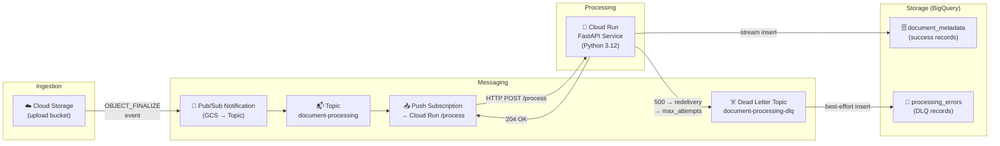

# 📄 GCP Serverless Document Processing Pipeline

A **serverless, event-driven** document processing pipeline built on Google Cloud.  
Users upload files to Cloud Storage; the upload triggers a Pub/Sub message; a Python Cloud Run service receives the message, runs simulated OCR, and streams extracted metadata to BigQuery.

---

## Architecture



### Component Summary

| Component | Technology | Purpose |
|---|---|---|
| **Ingestion bucket** | Cloud Storage | Receives user uploads (PDF, PNG, JPEG) |
| **GCS notification** | Pub/Sub Notification | Publishes `OBJECT_FINALIZE` events |
| **Topic** | `document-processing` | Message bus for upload events |
| **Push subscription** | Pub/Sub | Delivers messages to Cloud Run via HTTP POST |
| **Dead Letter Topic** | `document-processing-dlq` | Catches messages that fail ≥ 5 delivery attempts |
| **Processor** | Cloud Run (FastAPI) | Simulates OCR, extracts metadata |
| **Success storage** | BigQuery `document_metadata` | Stores extracted metadata for all processed files |
| **Error storage** | BigQuery `processing_errors` | Stores failure records from the DLQ |

---

## Project Structure

```
google-cloud-serverless-app/
├── app/
│   ├── __init__.py
│   ├── config.py            # Pydantic-settings configuration
│   ├── logging_config.py    # Structured JSON logging (Cloud Logging-compatible)
│   ├── models.py            # Pydantic domain models
│   ├── processor.py         # Simulated OCR + metadata extraction
│   ├── bigquery_client.py   # BQ streaming insert (success + error tables)
│   └── main.py              # FastAPI app — /health and /process endpoints
├── tests/
│   ├── __init__.py
│   ├── conftest.py          # Shared pytest fixtures
│   ├── test_processor.py    # Pure unit tests for processor logic
│   └── test_main.py         # API integration tests (BQ mocked)
├── scripts/
│   ├── init_local.py        # One-shot emulator provisioner (Docker Compose init)
│   └── send_test_message.py # Dev helper to inject test events
├── docker-compose.yml        # Full local stack (Pub/Sub + BigQuery emulators)
├── Dockerfile               # Multi-stage production image (Python 3.12-slim)
├── requirements.txt
├── requirements-dev.txt
├── pyproject.toml           # pytest configuration
├── .env.example
└── README.md
```

---

## BigQuery Schema

### `document_pipeline.document_metadata`

| Column | Type | Mode | Description |
|---|---|---|---|
| `filename` | STRING | REQUIRED | Basename of the uploaded file |
| `file_size` | INTEGER | REQUIRED | Size in bytes |
| `file_type` | STRING | REQUIRED | MIME type (e.g., `application/pdf`) |
| `gcs_uri` | STRING | REQUIRED | Full `gs://` URI |
| `word_count` | INTEGER | REQUIRED | Word count from simulated OCR |
| `simulated_tags` | STRING | REPEATED | Extracted keyword tags |
| `upload_timestamp` | TIMESTAMP | REQUIRED | When the file was uploaded to GCS |
| `processed_timestamp` | TIMESTAMP | REQUIRED | When processing completed |
| `processing_status` | STRING | REQUIRED | `"success"` |

### `document_pipeline.processing_errors`

| Column | Type | Mode | Description |
|---|---|---|---|
| `event_id` | STRING | REQUIRED | Pub/Sub message ID |
| `gcs_uri` | STRING | REQUIRED | Full `gs://` URI of the failed file |
| `error_message` | STRING | REQUIRED | Exception message |
| `raw_message` | STRING | REQUIRED | Raw JSON of the GCS notification |
| `failed_at` | TIMESTAMP | REQUIRED | When the failure was recorded |

---

## Local Development

### Prerequisites

- [Docker Desktop](https://www.docker.com/products/docker-desktop/) (with Compose v2)
- Python 3.12 (for running tests outside Docker)

### 1 — Start the Full Stack

```bash
docker compose up --build
```

This starts four services in order:
1. **`pubsub-emulator`** — Google Cloud Pub/Sub emulator on `:8085`
2. **`bigquery-emulator`** — goccy BigQuery emulator on `:9050`
3. **`init`** — creates topics, subscriptions, dataset, and tables, then exits
4. **`app`** — FastAPI service on `:8080`

Browse the **interactive API docs** at: http://localhost:8080/docs

### 2 — Send a Test Document Event

**Option A: Direct HTTP (fastest, no emulator needed)**

```bash
python scripts/send_test_message.py \
    --file documents/invoice_q1.pdf \
    --type application/pdf
```

**Option B: Via Pub/Sub emulator (full pipeline)**

```bash
PUBSUB_EMULATOR_HOST=localhost:8085 python scripts/send_test_message.py \
    --mode pubsub \
    --file images/scan.png \
    --type image/png
```

**Option C: curl directly**

```bash
NOTIFICATION=$(echo '{"bucket":"local-test-bucket","name":"test.pdf","size":"65536","contentType":"application/pdf","timeCreated":"2024-01-01T12:00:00Z"}' | base64 -w0)

curl -s -o /dev/null -w "%{http_code}" -X POST http://localhost:8080/process \
  -H "Content-Type: application/json" \
  -d "{
    \"message\": {
      \"data\": \"$NOTIFICATION\",
      \"messageId\": \"local-test-001\",
      \"publishTime\": \"2024-01-01T12:00:01Z\"
    },
    \"subscription\": \"projects/local-project/subscriptions/document-processing-sub\"
  }"
```

Expected response: `204`

### 3 — Run Unit Tests

Tests run **entirely without Docker or GCP credentials**:

```bash
# Create and activate a virtual environment
python -m venv .venv
.venv\Scripts\activate          # Windows
# source .venv/bin/activate     # Linux / macOS

# Install dependencies
pip install -r requirements-dev.txt

# Run all tests
pytest

# Run with coverage
pytest --tb=long -v
```

Expected output:
```
tests/test_processor.py::TestGetFileCategory::test_pdf_mime_returns_pdf   PASSED
tests/test_processor.py::TestSimulateOCRText::test_returns_non_empty_string_for_pdf   PASSED
... (30+ tests)
tests/test_main.py::TestProcessEndpoint::test_stream_error_failure_does_not_cascade  PASSED
========== 30 passed in 1.23s ==========
```

---

## GCP Manual Setup

> **No Terraform is included.** Run these `gcloud` commands to provision the required resources in your GCP project.

### Step 1 — Enable APIs

```bash
PROJECT_ID="your-gcp-project-id"
REGION="europe-west9"

gcloud config set project $PROJECT_ID

gcloud services enable \
    run.googleapis.com \
    pubsub.googleapis.com \
    bigquery.googleapis.com \
    storage.googleapis.com \
    cloudbuild.googleapis.com
```

### Step 2 — Cloud Storage Bucket

```bash
BUCKET_NAME="${PROJECT_ID}-document-uploads"

gcloud storage buckets create gs://$BUCKET_NAME \
    --location=$REGION \
    --uniform-bucket-level-access
```

### Step 3 — Pub/Sub Topics & Subscription

```bash
# Main topic
gcloud pubsub topics create document-processing

# Dead letter topic
gcloud pubsub topics create document-processing-dlq

# GCS → Pub/Sub notification (fires on every upload)
gcloud storage buckets notifications create gs://$BUCKET_NAME \
    --topic=document-processing \
    --event-types=OBJECT_FINALIZE \
    --payload-format=JSON_API_V1

# Push subscription (replace CLOUD_RUN_URL after Step 5)
CLOUD_RUN_URL="https://PLACEHOLDER.run.app"   # update after deploy

# Service account for Pub/Sub to authenticate with Cloud Run
PUBSUB_SA="pubsub-invoker@${PROJECT_ID}.iam.gserviceaccount.com"
gcloud iam service-accounts create pubsub-invoker \
    --display-name="Pub/Sub Cloud Run Invoker"

gcloud pubsub subscriptions create document-processing-sub \
    --topic=document-processing \
    --push-endpoint="${CLOUD_RUN_URL}/process" \
    --push-auth-service-account=$PUBSUB_SA \
    --dead-letter-topic=document-processing-dlq \
    --max-delivery-attempts=5 \
    --ack-deadline=60 \
    --min-retry-delay=10s \
    --max-retry-delay=300s
```

### Step 4 — BigQuery Dataset & Tables

```bash
bq mk --dataset \
    --location=EU \
    --description="Document processing pipeline" \
    ${PROJECT_ID}:document_pipeline

# document_metadata table
bq mk --table \
    ${PROJECT_ID}:document_pipeline.document_metadata \
    filename:STRING,file_size:INTEGER,file_type:STRING,gcs_uri:STRING,\
word_count:INTEGER,simulated_tags:STRING,upload_timestamp:TIMESTAMP,\
processed_timestamp:TIMESTAMP,processing_status:STRING

# processing_errors table
bq mk --table \
    ${PROJECT_ID}:document_pipeline.processing_errors \
    event_id:STRING,gcs_uri:STRING,error_message:STRING,\
raw_message:STRING,failed_at:TIMESTAMP
```

### Step 5 — Deploy to Cloud Run

```bash
# Build and push image
gcloud builds submit --tag gcr.io/$PROJECT_ID/document-processor .

# Deploy
gcloud run deploy document-processor \
    --image=gcr.io/$PROJECT_ID/document-processor \
    --region=$REGION \
    --platform=managed \
    --no-allow-unauthenticated \
    --service-account=pubsub-invoker@${PROJECT_ID}.iam.gserviceaccount.com \
    --set-env-vars="GCP_PROJECT_ID=${PROJECT_ID},GCP_REGION=${REGION},\
BIGQUERY_DATASET=document_pipeline,ENVIRONMENT=production,LOG_LEVEL=INFO" \
    --min-instances=0 \
    --max-instances=10 \
    --memory=512Mi \
    --timeout=60s

# Get the Cloud Run URL and update the Pub/Sub subscription
CLOUD_RUN_URL=$(gcloud run services describe document-processor \
    --region=$REGION --format='value(status.url)')

gcloud pubsub subscriptions modify-push-config document-processing-sub \
    --push-endpoint="${CLOUD_RUN_URL}/process" \
    --push-auth-service-account=$PUBSUB_SA
```

### Step 6 — IAM Permissions

```bash
# Allow Pub/Sub to invoke the Cloud Run service
gcloud run services add-iam-policy-binding document-processor \
    --region=$REGION \
    --member="serviceAccount:${PUBSUB_SA}" \
    --role="roles/run.invoker"

# Allow Cloud Run service account to write to BigQuery
gcloud projects add-iam-policy-binding $PROJECT_ID \
    --member="serviceAccount:pubsub-invoker@${PROJECT_ID}.iam.gserviceaccount.com" \
    --role="roles/bigquery.dataEditor"

# Allow Pub/Sub to publish to the DLQ topic
PUBSUB_AGENT="service-$(gcloud projects describe $PROJECT_ID \
    --format='value(projectNumber)')@gcp-sa-pubsub.iam.gserviceaccount.com"

gcloud pubsub topics add-iam-policy-binding document-processing-dlq \
    --member="serviceAccount:${PUBSUB_AGENT}" \
    --role="roles/pubsub.publisher"
```

---

## Design Decisions

### Why Pub/Sub Push (not Pull)?

Push subscriptions are the idiomatic pattern for Cloud Run: Pub/Sub delivers messages as HTTP POST requests and Cloud Run scales from zero to handle them. Pull requires a long-running poller process, which defeats the serverless model.

### Why 204 on success / 500 on failure?

Pub/Sub interprets any **2xx** as an acknowledgement (stop redelivery).  
A **non-2xx** response triggers automatic redelivery with exponential backoff.  
After `max_delivery_attempts` retries, the message is forwarded to the Dead Letter Topic — giving us automatic durability without any application-level retry logic.

### Why deterministic OCR seeding?

The simulated OCR uses `MD5(filename)` as a random seed. This makes processor output **reproducible** across calls, which means unit tests can assert on word counts and tags **without mocking** the random module.

### Why anonymous credentials for the BigQuery emulator?

The goccy BigQuery emulator has no authentication layer. Passing `AnonymousCredentials` prevents the SDK from attempting ADC lookup (which would fail in a container with no GCP credentials mounted).

### Structured JSON logging

Cloud Logging parses log lines that are valid JSON with a `severity` field, enabling:
- Log-level filtering in the Cloud Console
- Alerting on `ERROR`/`CRITICAL` severity
- `extra={}` fields becoming queryable JSON payload keys

---

## Environment Variables Reference

| Variable | Default | Description |
|---|---|---|
| `GCP_PROJECT_ID` | `local-project` | GCP project ID |
| `GCP_REGION` | `europe-west9` | Deployment region |
| `BIGQUERY_DATASET` | `document_pipeline` | BQ dataset name |
| `BIGQUERY_METADATA_TABLE` | `document_metadata` | Success records table |
| `BIGQUERY_ERRORS_TABLE` | `processing_errors` | DLQ records table |
| `PUBSUB_TOPIC` | `document-processing` | Main Pub/Sub topic |
| `PUBSUB_DLQ_TOPIC` | `document-processing-dlq` | Dead letter topic |
| `PUBSUB_SUBSCRIPTION` | `document-processing-sub` | Push subscription name |
| `ENVIRONMENT` | `development` | `development` or `production` |
| `LOG_LEVEL` | `INFO` | Python log level |
| `PUBSUB_EMULATOR_HOST` | *(unset)* | Set to redirect SDK to local emulator |
| `BIGQUERY_EMULATOR_HOST` | *(unset)* | Set to redirect SDK to local emulator |
# google-cloud-serverless-app

